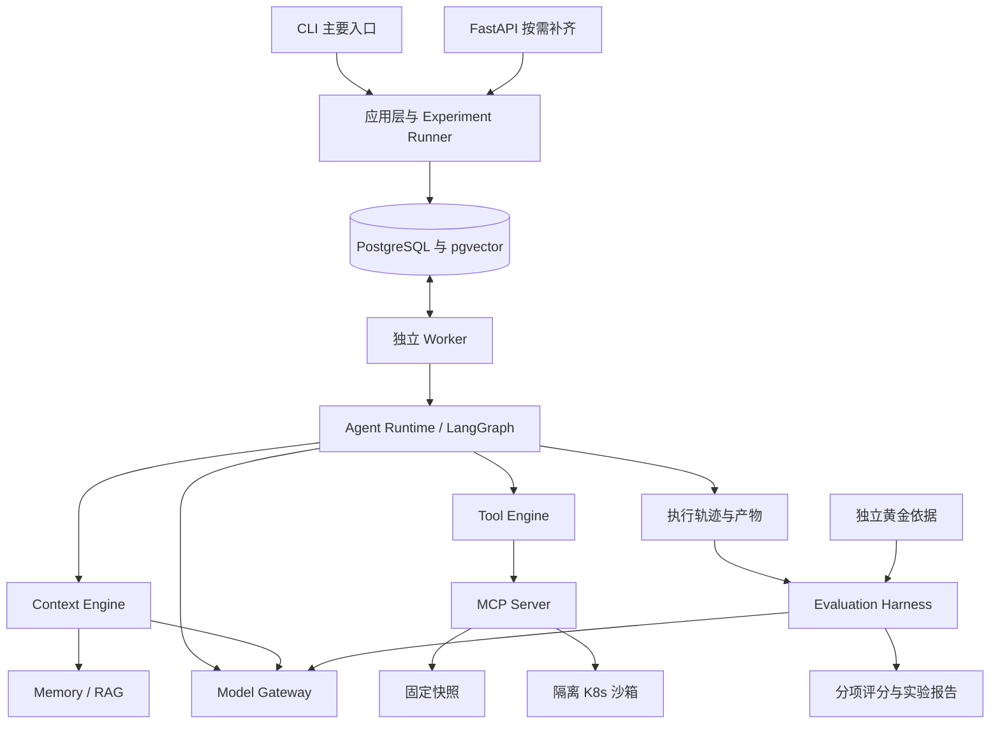

# observabilityAgent 系统架构设计 v1.0

更新日期：2026-10-17。本文记录本轮讨论确认的设计基线，业务能力尚待实现，未经过独立工程 Review。

本文是架构维护入口；[整体规划](project-roadmap.md)负责排期和阶段验收，[工程规范](engineering.md)负责共同规则，[协作指南](collaboration/README.md)负责交接与 Review。后续重要变更进入 [ADR](decisions/README.md)。同目录 Word 版为本版本的阅读快照，后续以本文为准维护。

## 1 摘要

项目定位为 Eval-Driven Agent Runtime：以 K8s 故障诊断和受控配置变更为场景，建设可评测、可恢复的 Agent 执行平台。核心是 Runtime、Context Engine 和 Evaluation Harness，通过实验回答上下文策略是否有效，以及异常后能否正确恢复。

采用 Python 模块化单体与独立 Worker。CLI 为首版主要入口，FastAPI 按需补齐；LangGraph 组织自建 Agent，PostgreSQL 保存任务与状态，pgvector 支持检索，MCP 连接工具环境。固定快照支撑主要对照实验，实时沙箱验证配置变更和恢复。执行端不读取黄金答案。

## 2 目标与范围

| 本期目标 | 首版不包含或不承诺 |
|---|---|
| 自建 ReAct Agent，多步工具调用与执行控制 | 通用外部 Agent 托管平台、通用插件市场 |
| 三种上下文策略可切换，保留模型输入和证据 | 单凭一次轨迹证明策略的因果效果 |
| 独立评测、版本化实验、成本与失败分析 | 预设优化一定提高成功率或降低成本 |
| Checkpoint、工具日志、崩溃恢复和沙箱验证 | 任意外部操作恰好执行一次，取消自动撤销副作用 |
| CLI、批量实验和报告，标准档部署验证 | 首版 Web UI、生产多租户和高可用承诺 |

沿用 12 周、225 小时标准规划。Memory/RAG、两个真实模型后端属于交付目标；Planner/Executor 与 Reflection 为标准档对照，多 Agent 为可选扩展。本文不新增排期，不以接口和目录数量衡量复杂度。

## 3 当前基础与问题

当前只有 Python 3.11 的 src 工程、Pydantic Settings、FastAPI 应用工厂与 `/healthz`。已有 uv 锁文件、Ruff、mypy、pytest、CI，以及仓库外 wheel 安装检查。现有 ASGI 测试不驱动 lifespan，不代表真实进程和外部依赖就绪验证。

Runtime、数据库、Context、Evaluation、Memory/RAG、MCP、CLI/Worker 及实验环境均未实现。下文为目标设计，不是已有功能清单。

模型与工具循环之外，必须区分任务定义与执行实例，冻结实验输入，保存实际上下文，处理外部操作和 Checkpoint 间的不一致，并将执行完成与任务正确分别判断。

## 4 总体架构与模块职责

### 4.1 系统边界

箭头表示主要调用或数据流，不代表每个方框独立部署。核心逻辑通过 Python 接口调用，不经内部 HTTP 绕行。Context 和 Evaluator 可按职责直接调用 Model Gateway。

### 4.2 模块边界

| 模块 | 职责和主要输出 | 边界 |
|---|---|---|
| 应用层 / Runner | 校验并冻结配置，展开 Task × 策略 × 重复次数，创建 Run、查询进度和汇总 | 不执行 Agent 内部步骤 |
| Worker | 领取 Run、维护执行权、驱动执行或评测、处理取消和失联恢复 | 不决定上下文内容和诊断结论 |
| Runtime | LangGraph/ReAct、执行控制、状态、Checkpoint、终止与事件 | 不读取答案，不依赖 FastAPI |
| Context Engine | 选择、去重、预算、压缩、笔记和模型输入组装记录 | 不决定权限，不替代完整历史 |
| Tool Engine | Tool Calling 校验、MCP 适配、超时、重试、工具日志和副作用处理 | 不开放任意 Shell；MCP 不是权限隔离 |
| Model Gateway | 后端适配、能力声明、调用控制、输出校验和用量 | 不隐藏业务 Prompt，不静默切换模型 |
| Memory / RAG | 记忆更新、隔离、检索，知识索引和来源 | 不把全部对话自动沉淀为事实 |
| Evaluation | 独立规则与 Judge、轨迹及抽样上下文评分、失败分类和报告 | 不泄漏答案或评分到执行路径 |
| 存储 Adapter | 元数据、状态、证据和大产物引用 | 不用普通日志代替恢复状态 |

### 4.3 进程与部署

一个 Python 工程提供 CLI、Worker、HTTP 三个入口，复用应用用例。首版用 PostgreSQL 任务表排队；Worker 可运行多个进程，不先引入 Redis/Celery。MCP Server 因协议及环境边界独立运行。

执行和评测代码分开；同一个 Worker 程序可按任务类型驱动两者。答案加载能力只注入评测路径。这属于代码和数据访问边界，不宣称操作系统级权限隔离。

Docker Compose 组织平台与依赖。平台自身部署与被诊断的 K8s 应用分别说明；有实验 K8s 环境不代表平台已部署到 K8s。大产物先放在 Worker 可访问的本地目录，数据库保存引用与校验信息；跨机器运行前必须配置共享存储或对象存储 Adapter。

## 5 数据流与执行生命周期

### 5.1 实验与执行

1. CLI 提交数据集版本、任务筛选、策略矩阵、模型角色、预算、并发和重复次数；应用层校验并冻结配置，创建 Experiment 与 Run。
2. Worker 用短事务领取 Run，登记租约和执行权版本后立即提交；不在模型或工具调用期间持有领取行锁。
3. 加载可见任务、对应快照或沙箱、Memory 初始版本、Prompt 和工具定义；恢复时加载有效 Checkpoint 与工具日志。
4. 每次模型调用前由 Context Engine 组装预算内输入，记录来源与取舍；Gateway 保存实际调用、响应、错误和用量。
5. Runtime 校验模型行动；工具调用先登记逻辑操作，再由 Tool Engine 校验、执行、保存结果。步骤推进时保存 Checkpoint。
6. 完成、失败、取消或待确认时更新 Run。完成仅表示执行结束，正确性由 Evaluation 独立判断。
7. Evaluator 读取封存轨迹、结果及评测依据，保存版本化评分；Runner 汇总报告。重新评分不改变 Run 的执行状态。

### 5.2 上下文流

完整历史由 Runtime 及存储保存；摘要和笔记由 Context Engine 管理；实际模型输入为派生结果。压缩不删除原始证据，摘要结论应可回取来源。

三种策略共用输入契约、输入上限和输出预留规则：Sliding Window、Summary + Recent、Retrieval + Budget + Compression。切换策略不修改 Runtime。摘要、检索相关模型调用和压缩费用单列统计。

用户约束、写权限、当前目标、未解决问题和待确认工具结果属于受保护内容。关键事实和反证保留来源；受保护内容超过预算时明确报错或暂停，不静默截断。裁剪消息时保留工具调用与结果的协议配对。

结构化笔记采用固定字段：已确认事实、待验证假设、反证、未完成步骤、下一步。模型提出更新，程序检查 Schema、证据引用与受保护字段；失败则保留旧版并记录错误。格式校验通过不等于语义正确。

每步保存策略版本、候选及取舍依据、证据标识、摘要和笔记版本、Token 估算及实际用量、完整模型输入。记录可观察的说明与输入输出，不要求提供模型内部思维链。

### 5.3 Memory 与 RAG 流

RAG 保存冻结版本的手册、排障指南和应用说明；Memory 保存环境事实和有证据的操作经验；任务笔记保存当前 Run 的工作状态。任务结束后独立提出记忆候选，检查来源、格式和冲突后版本化保存，区分已验证事实与待验证经验。

普通实验各组从同一冻结 Memory 快照开始，新增记忆互不共享。跨会话实验按任务序列积累记忆，各组和各次重复隔离；开发集记忆不得流入最终测试集。跨会话序列按依赖顺序调度，不能将后置任务任意并行。

### 5.4 数据环境与配置变更

数据来自固定版本的开源应用、受控流量和故障注入，采集日志、指标、事件及配置。Snapshot Adapter 查询冻结数据，按服务、时间和关键词等条件过滤，不按题目直接返回答案。Sandbox Adapter 提供实时查询和受控写入。两种模式的读取结果尽量共用结构，标注来源、采集时间和环境。

首个写场景是设置指定 Deployment 的目标副本数，工具为 `get_deployment`、`set_deployment_replicas`、`wait_deployment_ready`。限定资源、命名空间与副本范围，使用版本前提检查，不开放任意配置提交。

配置被接受不等于任务成功，需独立检查可用副本数、超时和违规。同一沙箱写任务串行，每次执行前重置并核验初始状态，结束后保存证据；重置失败停止后续任务。恢复仍属原 Run，不能误走新任务的重置流程。快照读取任务可并发。

## 6 状态与数据契约

下表是语义契约；具体字段、表结构和目录随模块任务确定，不代表已发布 Schema。

| 对象 | 保存内容 | 归属 |
|---|---|---|
| Experiment | 数据集、代码、模型参数、Prompt、策略、工具、知识和 Memory 初始版本，启动后冻结 | Runner |
| Task | 可复用问题、可见环境、约束和快照引用；黄金依据分开 | 数据集 |
| Run / Attempt | 一次执行与恢复尝试、状态、租约、执行权版本、终止原因和时间 | Worker / Runtime |
| Checkpoint | 图状态、消息引用、进度、笔记版本与恢复位置 | Runtime |
| Tool Journal | 逻辑操作标识、参数、前置状态、尝试、结果及不确定状态 | Tool Engine |
| Context Build | 每步实际输入、候选取舍、预算、证据和派生版本 | Context Engine |
| Memory / Knowledge | 命名空间、来源、版本、适用环境、更新与失效关系 | Memory / RAG |
| Evaluation | Run/轨迹版本、评分依据、Judge 配置、分项结果与错误 | Evaluator |
| Trace / Artifact | 事件和完整调用产物；大文件引用与校验信息 | 存储模块 |

Run 状态为 `PENDING`、`RUNNING`、`WAITING_APPROVAL`、`COMPLETED`、`FAILED`、`CANCELLED`。超时、预算耗尽写入失败原因，不为每种错误新增状态。待确认后恢复需重新取得执行权；终态不直接改回运行中，完整重跑创建关联的新 Run。

恢复保留 run_id，新增 attempt；实验重复执行则创建新 run_id。评测有独立生命周期，评测异常不等于 Agent 执行失败。Experiment 进度由 Run 汇总，执行完成不等于评测通过。

Runtime 接收可见任务和执行配置；Context 返回模型输入与来源记录；Tool Engine 返回标准结果与副作用状态；Gateway 返回响应、能力错误与用量；Evaluator 接收封存产物和独立依据。共享契约可序列化、可版本化，不依赖 HTTP 或 LangGraph 内部类型。

## 7 一致性与恢复

任务领取采用 PostgreSQL 短事务及 `FOR UPDATE SKIP LOCKED`，配合租约、心跳和执行权版本。失联回收核对当前租约并限制恢复次数；旧 Worker 写业务状态必须校验执行权。LangGraph Checkpoint 保存图状态，不能自动解决外部操作是否发生的问题。

| 场景 | 处理方式 | 限制 |
|---|---|---|
| 多 Worker 领取 | 原子领取不同 Run，提交后执行 | 行锁不持续覆盖模型和工具调用 |
| Worker 失联 | 租约过期后检查恢复资格，新增 attempt | 失联不证明外部操作未发生 |
| 写成功但未存 Checkpoint | 查询日志并回读资源，已达目标则继续验证 | 值相同不总能证明操作归属 |
| 仍为旧配置 | 满足原版本及修改条件时重试同一操作 | 第三方修改或归属不明则暂停 |
| 工具结果不确定 | 回读核实、实际支持的幂等键，或人工确认 | 不盲目重试非幂等操作 |
| 数据库不可写 | 停止领取和新副作用，恢复后对账 | 已在途操作仍可能完成 |
| 取消或超预算 | 步骤边界检查，终止后续调用，记录在途结果 | 不自动撤销已发生修改 |
| 执行中配置变更 | 沿用冻结配置，新配置另开实验 | 不静默切换模型和 Prompt |

同一逻辑工具操作的标识跨 attempt 稳定，新行动使用新标识。租约约束执行权和受控写入；外部资源仍需版本前提和回读。Checkpoint Adapter 能否防护旧 Worker 写入必须验证，无法防护时不得立即并发接管旧进程。

文件先持久写入并校验，再发布数据库引用；数据库与文件没有天然原子事务，需要识别未完成写入、缺失引用和孤立文件。所有声明可恢复的场景均以故障注入验证。

## 8 权限与数据边界

首版用于个人可信本地或私有实验环境。写工具最终校验沙箱命名空间、资源和参数白名单，权限不由摘要决定。MCP 结果及检索文本视为数据，不能扩大权限或改写系统约束。

密钥保存在环境配置，不进入仓库、Prompt、轨迹和报告。输入输出在记录前必要脱敏，各 worktree 独立维护配置、产物和外部资源。黄金答案与注入信息不进入执行端和检索索引。清理覆盖引用关系，不提前删除保留实验所需证据；具体保留期随数据任务确定。

## 9 技术栈与工程验证

### 9.1 技术栈与配置

| 层次 | 选择 | 状态 |
|---|---|---|
| 语言与工程 | Python 3.11、src、uv、Pydantic Settings | 已有 |
| 接入 | FastAPI、CLI、独立异步 Worker | HTTP 最小实现，其他待建 |
| Agent | LangGraph、LangChain、ReAct、Prompt Engineering、Tool Calling | 目标，按需引入 |
| 工具 | MCP、Snapshot / K8s Sandbox Adapter | 目标 |
| 状态与检索 | PostgreSQL、pgvector、数据库迁移 | 目标，迁移工具待定 |
| 模型 | 统一 Gateway、两个真实后端 | 目标，模型待定 |
| 评测 | 规则检查、LLM-as-judge、人工校准 | 目标 |
| 验证与部署 | Ruff、mypy、pytest、CI；Compose / K8s | 检查已有，部署待建 |

模型区分 agent_model、context_model、judge_model，可指向相同或不同后端。业务模块维护 Prompt，Gateway 只适配调用。网络、限流、格式修正分别记录并有限重试；参数错误交回 Runtime，能力不足显式失败，不静默降级。

配置分为非敏感实验配置、进程环境配置和模型凭据；解析后的配置脱敏封存。当前 `.env` 相对进程工作目录加载，入口从当前 worktree 根目录启动，不声称任意目录自动发现配置。运行时 API 与 ChatGPT Plus、Claude Code 的开发消费分别统计。

### 9.2 评测与观测

所有任务做结果与完整轨迹评测，失败任务及少量抽样任务做逐步上下文评测。结果、过程、上下文质量、工程表现分别报告，不合成总分，违规不能被其他得分抵消。确定性检查优先；Judge 评估证据支持、摘要忠实度和语义完整性，保存量表、模型、Prompt、输入及人工校准。

上下文丢证据、工具没取到证据、模型看到却误判分别记录为归因线索，不直接当作因果结论。开发与最终测试按模板/场景分组，重复关键实验报告波动，保留不利结果。

| 验证对象 | 必须保留的证据 |
|---|---|
| 结果 | 诊断答案与来源，沙箱目标配置和实际可用状态 |
| 表现 | 完成率和成功率分别统计，平均/P95 耗时、工具次数、错误分类 |
| 上下文 | 实际模型输入、Token、策略和派生版本、抽样忠实度 |
| 成本 | Agent、Context、Planning、重试、Judge 分项；执行与含评测总成本分开 |
| 恢复与并发 | 崩溃位置、接管、重复副作用、旧 Worker 写入与隔离验证 |

报告每任务平均成本和总成本/成功任务数的摊销成本，明确是否含评测，零成功标为不适用。未知调用费用不填零。Mock 与真实模型结果分开。并发、SLO、租约时间和告警阈值通过基线测量确定，不虚构生产指标。

日志用于排障，Trace 用于审计评测，Checkpoint 用于恢复；通过 experiment_id、run_id、attempt、step、工具操作标识关联。平台观测与实验应用业务观测数据分别管理。

### 9.3 开发规范与完成标准

核心逻辑不依赖 FastAPI；SDK 与存储访问集中到必要 Adapter。使用类型提示、明确异常分类、资源生命周期与数据库迁移。I/O 异步，并发受 Worker 和调用预算统一控制，不在模块内无限创建任务；循环均有步骤、时间、Token 或重试上限。

保留少量必要抽象，第二个实现或测试替换确有需要时提取接口，不建设通用插件平台，不要求每个类都配接口。源目录随切片建立，不预建空模块。

检查入口为 `./scripts/verify.sh`。单元测试覆盖预算、状态、选择和校验；集成测试覆盖持久化、模型及 MCP 契约；故障测试覆盖超时、取消、崩溃窗口和旧 Worker；端到端覆盖快照诊断与沙箱变更。普通测试不消耗真实 API，真实模型和沙箱检查显式触发、记录环境及费用。

Codex/CC 使用任务卡、指定 commit、交接和独立 Review。同一目录串行写入，并行使用独立 worktree。自查不替代独立 Review，只记录实际运行的检查，按用户授权提交、推送和合并。

## 10 方案取舍

| 备选 | 优点 | 本期选择理由 |
|---|---|---|
| Redis/Celery | 成熟任务分发 | 首版沿用 PostgreSQL，新队列仍不能解决外部副作用 |
| 多微服务 | 独立扩缩容 | 单体加 Worker 减少部署与跨服务事务负担 |
| 全实时评测 | 贴近实际 | 快照对照加沙箱验证，控制环境漂移 |
| 每步全量 Judge | 粒度细 | 完整轨迹加失败/抽样逐步评测，控制成本 |
| 通用外部 Agent 接入 | 覆盖面广 | 先验证自建 Agent，轨迹和评测接口保持独立 |
| Web UI 优先 | 展示直观 | CLI 和报告优先，保障核心实验交付 |

## 11 待定事项

以下随对应实施任务确定，不阻塞概要设计：

- 实验应用、故障模板、采集快照格式和沙箱搭建方式。
- 两个真实模型、Embedding/Rerank、Token 计数方式。
- Schema、数据库访问及迁移工具、Checkpoint 兼容性和执行权校验。
- 租约、心跳、预算、重试与并发默认值，资源白名单和人工确认入口。
- Judge 量表、抽样比例、波动统计和检索质量标注，针对具体任务的去偏差机制。
- 数据保留期、脱敏、远程共享存储和可观测性集成。

## 12 实施顺序与验收

排期以 [整体规划](project-roadmap.md) 为准，按可运行切片推进：

| 阶段 | 交付 | 退出条件 |
|---|---|---|
| M1 第 1—4 周 | 契约、快照/MCP、Runtime、基础持久化和规则评测 | CLI 多步诊断、轨迹和终止可查、任务集可批跑复现 |
| M2 第 5—8 周 | 三种 Context、笔记、Memory/RAG、Judge、版本化实验 | 策略可切换、证据可回取、记忆隔离、人工校准及报告 |
| M3 第 9—12 周 | 沙箱变更、恢复/并发深化、Planning、部署与最终实验 | 崩溃窗口验证、保守恢复、标准档四组实验及 Demo |
| 第 13 周缓冲 | 修复和交付材料 | 补齐验收，不扩展新功能 |

下一开发任务先明确最小 Task、Run、事件、证据与快照工具契约，接通“快照诊断 → 实际上下文 → 多步工具调用 → 轨迹 → 独立规则评分”。沙箱环境和受控工具可先验证，写操作和恢复深化逐步加入；设计文档不代替实现验收。

## 参考

- [PostgreSQL SELECT 与 SKIP LOCKED](https://www.postgresql.org/docs/current/sql-select.html)：队列表并发领取机制。
- [LangGraph Persistence](https://docs.langchain.com/oss/python/langgraph/persistence)：图状态 Checkpoint 与跨线程 Store 的职责。
- 整体规划、共享工程规范和本轮逐项确认的架构讨论。
