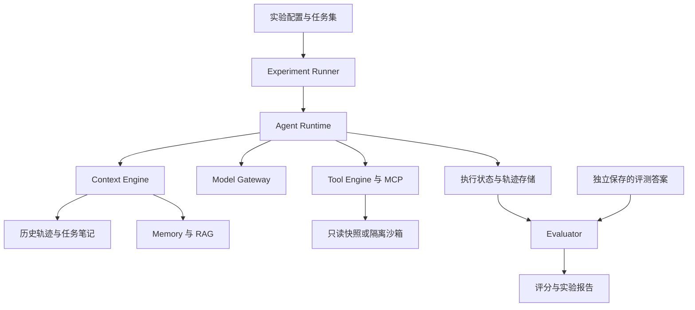
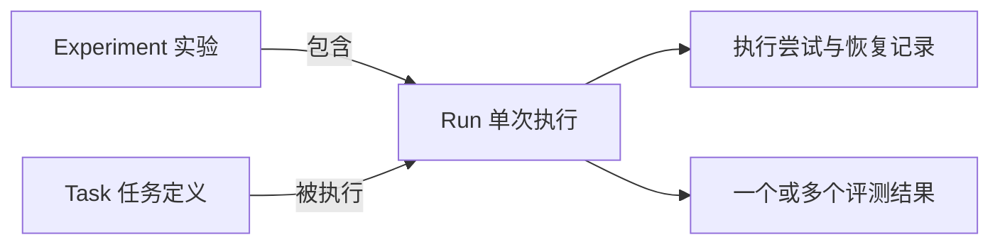

# 架构设计讨论原文 2026-10-17

## 归档范围说明

以下说明为归档元数据，不属于对话原文。

- 来源：当前会话的本地原始会话日志；会话 ID 为 `01a1113e-f996-7ca0-bd28-26aa17d28253`。
- 时间口径：以本次归档请求的消息时间为截止点，向前一小时，Asia/Shanghai **2026-10-17T22:28:26.732+08:00 至 2026-10-17T23:28:26.732+08:00**。
- 主题筛选：从该时间窗内首次提出 System Design 架构文档的消息起，连续保存架构讨论、用户确认、三组选项问答、落盘进度与交付回复，并保留本次归档请求。该主题开始时间为 **2026-10-17T22:54:06.052+08:00**；更早的协作配置实施与 Git 推送不属本次架构讨论。
- 原样口径：消息正文直接取自原始记录，不改写、不总结、不校正错字；仅添加角色、时间戳和边界标记。正文原有换行及 Markdown 均保留。三次选项问答按日志里的原始 JSON 保存。
- 不收录系统/开发者指令、自动注入的 skill 正文、内部推理和普通工具调用输出。未用对话摘要补写缺失内容；该主题在此时间窗内的可见文本和选项回答均已获取。
- 共 44 条记录，其中用户/Codex 消息 38 条，选项提问与回答 6 条。
- 每条消息标题下的 SHA-256 校验其正文 UTF-8 字节；BEGIN/END 标记之间的正文可与日志逐条核对。

## 对话原文

### 01 用户 | 2026-10-17T22:54:06.052+08:00

正文 SHA-256：`f68b7f56c0d6ec3d05a339fbb1799ee0e01105fa5409b0d990b8855db72758f2`

<!-- BEGIN MESSAGE 01 -->
[$openai-templates:artifact-template-system-design](/Users/zhangyiwei/.codex/plugins/cache/openai-curated-remote/openai-templates/0.1.1/skills/artifact-template-system-design/SKILL.md) 我现在需要一份架构设计文档，包括定义总体架构、模块职责、数据流，系统概要架构与模块边界、技术栈、开发规范与约束这些内容。
你和一起头脑风暴，把这个文档完成。注意，你可以探寻别的可以用的skill来和我一起探讨。

<!-- END MESSAGE 01 -->

### 02 Codex 过程说明 | 2026-10-17T22:54:19.332+08:00

正文 SHA-256：`11388b1956ed50361ad4226ab336fc9ce9f926800dee3a9a27d9b723ebbdd5d2`

<!-- BEGIN MESSAGE 02 -->
我会使用你指定的 System Design 模板，并结合 documents 技能准备文档。先读取模板和仓库里的规划，再从会影响模块边界、数据流的关键决策开始和你讨论。

<!-- END MESSAGE 02 -->

### 03 Codex 过程说明 | 2026-10-17T22:55:49.400+08:00

正文 SHA-256：`4b6bfd0f0ef872389dc1287aef456ed7cbd93e923de7257e0e48dd59ef8fd727`

<!-- BEGIN MESSAGE 03 -->
模板已确认，覆盖总体架构、请求生命周期、数据契约、一致性与恢复、运维和技术取舍。技术栈、开发规范和约束会补入对应章节。

我建议先确定两条主链路：任务执行链路负责运行和保存轨迹，评测链路读取轨迹与独立答案进行评分。它们共享版本化数据，但评分不直接干预被测 Agent。下面三个选择会决定首版的范围和文档形式。

<!-- END MESSAGE 03 -->

### 04 用户 | 2026-10-17T22:55:54.803+08:00

正文 SHA-256：`0ff6fd752acd073ab9554a828586aefe4023a4132e47785339f9f44deeaf9eb2`

<!-- BEGIN MESSAGE 04 -->
我说的是咱俩一起探讨，有问题可以和我对齐。

<!-- END MESSAGE 04 -->

### 05 Codex 过程说明 | 2026-10-17T22:56:15.635+08:00

正文 SHA-256：`dc92a9d38e371789fb05091cd62ad9ed84b6a79af9dbf31b1b858254ebbb0361`

<!-- BEGIN MESSAGE 05 -->
明白，我们就一项一项讨论，确定后再沉淀到文档里。

先聊一个会影响总体架构的问题：**这个系统的主要使用方式是什么？**

我倾向于“离线实验优先”：你选一批故障任务，配置模型和上下文策略，批量运行，再查看成功率、成本和失败轨迹。这样能尽早验证评测与上下文工程的价值。

另一种是“在线诊断优先”：用户提交一个告警，系统持续展示调查过程和诊断结果，评测作为后续分析。它的演示更直观，但首期需要更多任务调度和交互工作。

<!-- END MESSAGE 05 -->

### 06 Codex 选项提问 原始 JSON | 2026-10-17T22:56:18.401+08:00

正文 SHA-256：`a557ff6117479522914567093f8f9603661983b5295c1c744046b238b61b4764`

<!-- BEGIN MESSAGE 06 -->
{"questions":[{"header":"主要用法","id":"primary_usage","question":"你希望首版主要围绕哪种使用方式设计？也可以直接描述你设想的一次完整使用过程。","options":[{"label":"离线实验优先 (Recommended)","description":"围绕任务集、策略对照、批量运行和实验报告建设，单任务诊断作为基础能力。"},{"label":"在线诊断优先","description":"围绕提交告警、查看调查进度和诊断结果建设，评测作为运行后的分析能力。"}]}]}
<!-- END MESSAGE 06 -->

### 07 用户选项回答 原始 JSON | 2026-10-17T22:56:33.962+08:00

正文 SHA-256：`c68286abd91a43478d7186d9438ea31c20636d018b2bd768dbf440d8b0bc79c1`

<!-- BEGIN MESSAGE 07 -->
{"answers":{"primary_usage":{"answers":["离线实验优先 (Recommended)"]}}}
<!-- END MESSAGE 07 -->

### 08 Codex 过程说明 | 2026-10-17T22:56:59.691+08:00

正文 SHA-256：`314154dc0f7de6328a3b15f1e8e082afa2e632fd819f2e51a272c3ec87e14a23`

<!-- BEGIN MESSAGE 08 -->
那就定为**离线实验优先**。核心使用过程是：

**选择任务集 → 配置模型和策略 → 批量执行 → 保存轨迹 → 评分并生成对比报告。**

这里的“离线”指实验式运行，模型仍然可以调用云端 API。按已有规划，日常实验主要查询固定快照，另用少量真实环境任务验证。

接下来有个取舍：**首版要不要包含写操作？** 只读诊断足以比较答案质量和上下文策略；如果要验证“工具执行成功但进程崩溃后，恢复时是否重复操作”，就需要一类有副作用的操作。

我建议加入一类范围明确的沙箱写操作，例如更新隔离环境中的测试配置，专门用于验证执行日志、幂等和恢复。

<!-- END MESSAGE 08 -->

### 09 Codex 选项提问 原始 JSON | 2026-10-17T22:57:02.316+08:00

正文 SHA-256：`f8657d54863695b324aba85b141f403ba64b4d9bd2a64bd9b50aaaa9645f4091`

<!-- BEGIN MESSAGE 09 -->
{"questions":[{"header":"任务范围","id":"task_action_scope","question":"首版的任务范围，你更倾向哪一种？","options":[{"label":"诊断加一类沙箱写操作 (Recommended)","description":"诊断和策略实验为主，增加一类受控操作来验证副作用、幂等及崩溃恢复。"},{"label":"只读故障诊断","description":"先验证诊断质量、上下文和执行进度恢复，写操作的可靠性留到后续阶段。"}]}]}
<!-- END MESSAGE 09 -->

### 10 用户选项回答 原始 JSON | 2026-10-17T22:57:20.204+08:00

正文 SHA-256：`99c5beff0f62e90408cfda7d3153b66d41e63a20cf57287f57bf6ae0a96ef6db`

<!-- BEGIN MESSAGE 10 -->
{"answers":{"task_action_scope":{"answers":["诊断加一类沙箱写操作 (Recommended)"]}}}
<!-- END MESSAGE 10 -->

### 11 Codex 过程说明 | 2026-10-17T22:58:16.780+08:00

正文 SHA-256：`9204dde4ffa197c949a7ffbc95f561d942df55c6db30228eea418f3c5aff13b4`

<!-- BEGIN MESSAGE 11 -->
好，首版就采用“**诊断为主，加一类沙箱写操作**”。这让我们能分别验证诊断质量，以及执行日志、幂等和恢复行为。

还有一个会影响模块边界的问题：**首版评测谁？**

我建议先评测我们自己的 LangGraph Agent，允许切换模型、Prompt 和上下文策略，同时把轨迹与评分接口独立出来。这样首版可以专注把实验做可信，后续再接第二种 Agent，验证这些接口是否足够通用。

<!-- END MESSAGE 11 -->

### 12 Codex 选项提问 原始 JSON | 2026-10-17T22:58:19.025+08:00

正文 SHA-256：`c68c54c53c7dacd8b3aafa4a6fee6e931b5ddaabfd4a37b9700c53bff42252f7`

<!-- BEGIN MESSAGE 12 -->
{"questions":[{"header":"平台边界","id":"agent_extensibility","question":"你希望首版支持的被测 Agent 范围是什么？","options":[{"label":"自建 Agent 优先 (Recommended)","description":"先支持项目内的 LangGraph Agent 和策略切换，独立设计轨迹与评测接口，后续再接外部 Agent。"},{"label":"首版接入外部 Agent","description":"首版就支持其他框架的 Agent，需要同步建设接入适配、轨迹规范和兼容性验证。"}]}]}
<!-- END MESSAGE 12 -->

### 13 用户选项回答 原始 JSON | 2026-10-17T22:58:30.020+08:00

正文 SHA-256：`0198164881779b49bb07f8fa785fc11f9bf52bed61008ce90c41847f8e30498b`

<!-- BEGIN MESSAGE 13 -->
{"answers":{"agent_extensibility":{"answers":["自建 Agent 优先 (Recommended)"]}}}
<!-- END MESSAGE 13 -->

### 14 Codex 回复 | 2026-10-17T22:59:02.253+08:00

正文 SHA-256：`df8f84f7c107223839bb3a4327f9bc886ea623bf01978ea3851cf4f53d76c5ea`

<!-- BEGIN MESSAGE 14 -->
目前锁定了三个方向：

- **离线实验优先**：围绕任务集、策略配置、批量运行和报告建设。
- **诊断加一类沙箱写操作**：同时验证任务质量与恢复、幂等行为。
- **自建 Agent 优先**：首版聚焦 LangGraph Agent，独立设计轨迹和评测接口。

我建议总体架构先围绕这张草图讨论：



这里最值得先讨论的是 **Experiment Runner 和 Agent Runtime 的边界**：

- **Runner 管一组实验**：选择任务、固定配置、控制并发、安排重复运行、汇总结果。
- **Runtime 管一次任务执行**：构造上下文、调用模型和工具、保存状态、处理中断与恢复。
- **Evaluator 判断执行质量**：读取结果和轨迹评分，其答案与判断过程不进入被测 Agent。

这个划分能避免一个问题：把批量调度、Agent 决策和评分逻辑全塞进同一个 LangGraph 图，后续每改一种实验方式都要改运行时。

我倾向于让 **LangGraph 主要承担单任务 Runtime**，Runner 和 Evaluator 保持普通 Python 模块。下一步咱们可以沿着这个边界，讨论“一次实验”和“一次任务”分别需要保存哪些状态。
<!-- END MESSAGE 14 -->

### 15 用户 | 2026-10-17T23:00:12.877+08:00

正文 SHA-256：`9d65d1e40408b5c2f4815587775d248aacacdcfe5d9d77082b89bb88ec402486`

<!-- BEGIN MESSAGE 15 -->
典型的系统里要保存哪些状态？

<!-- END MESSAGE 15 -->

### 16 Codex 回复 | 2026-10-17T23:00:59.739+08:00

正文 SHA-256：`441c4d78ed28706e89a7e0d8aec43f1d718c7038241221f1eeefdda9e5b1471e`

<!-- BEGIN MESSAGE 16 -->
对咱们这个项目，建议先区分四类信息：**执行前固定的配置、执行中的进度、恢复所需的状态、执行后的结果与证据。**

具体可以分成下面几层：

| 层级 | 需要保存什么 | 作用 |
|---|---|---|
| **Experiment 实验** | 任务集版本、模型与参数、Prompt 版本、上下文策略、重复次数、并发配置、开始与结束时间 | 确认“这次实验到底用了什么条件” |
| **Task 任务定义** | 问题、环境／快照版本、约束、允许的工具、任务类型 | 描述一道可重复执行的题；黄金答案单独保存 |
| **Run 单次执行** | 所属实验与任务、运行状态、当前阶段、尝试次数、预算消耗、终止原因 | 管理某一道题的某一次运行 |
| **Runtime Checkpoint** | 当前执行节点、下一步、已保存的消息与任务状态、上下文引用 | 进程中断后知道从哪里继续 |
| **Tool Execution 工具执行** | 调用参数、执行状态、幂等键、尝试记录、返回结果、错误、时间 | 判断工具做过什么，恢复时能否再次调用 |
| **Context 上下文** | 任务笔记、事实与假设、关键约束、证据引用、摘要版本、实际模型输入 | 继续调查，并解释不同上下文策略的行为差异 |
| **Evaluation 评测** | 评分器及标准版本、评分状态、各维度结果、依据、评测错误 | 独立判断质量，支持更换评分器后重新评分 |
| **Trace 与产物** | 模型调用、工具事件、状态变化、用量、最终报告及原始证据引用 | 排查失败、回放和生成实验报告 |

这里有几个区别很重要。

**第一，Task 和 Run 要分开。**  
例如“诊断某次配置错误”是一道 Task。用两种上下文策略，各重复三次，就会产生 **6 个 Run**。每个 Run 有独立进度、轨迹和评分，不能把运行状态直接写在任务定义上。

**第二，运行完成和答对是两回事。**  
一个 Run 可以正常结束并输出诊断报告，但根因判断错误。因此应分别记录：

- 执行状态：排队、运行中、等待人工确认、完成、失败、取消等。
- 评测结果：根因是否正确、证据是否充分、成本是多少。

同样，Judge 调用失败，也不应把已经完成的 Agent 执行改成失败。

**第三，Checkpoint 和工具执行记录不能合并成一个概念。**

假设发生了：

> 工具成功修改沙箱配置 → 进程崩溃 → 尚未保存新的 Checkpoint。

仅看 Checkpoint，系统可能认为工具还没执行。工具执行记录就要帮助识别这次操作；如果仍无法确认结果，应记录为“**执行结果未知**”，再查询实际状态、利用幂等能力或等待人工确认，不能直接重试。

**第四，上下文需要保存“当时实际看到了什么”。**  
只有原始轨迹不够，因为压缩策略可能删掉了关键反证。我们需要保留实际模型输入、摘要／笔记版本及证据引用，才能分析错误来自检索、压缩还是模型判断。这里记录可观察的输入输出和任务状态，不要求保存模型内部思维链。

存储上，我建议：

- **PostgreSQL** 保存配置、运行状态、Checkpoint、工具日志和评分元数据。
- **文件或对象存储** 保存大日志、完整模型输入输出、快照及报告，数据库保存引用。
- 实验完成数量等汇总值，优先根据各 Run 的状态计算，减少两份状态不一致的问题。

下一步设计时，最先定义的应该是 **Experiment、Task、Run 三者的关系，以及 Run 的状态转换**。其他状态围绕一次 Run 展开，会比较容易理清。
<!-- END MESSAGE 16 -->

### 17 用户 | 2026-10-17T23:02:04.093+08:00

正文 SHA-256：`37bdeb7f5da1bb9f85d5edcd19ad745cff457454f7089643cfe163d86a7c9a0b`

<!-- BEGIN MESSAGE 17 -->
很好，继续吧。

<!-- END MESSAGE 17 -->

### 18 Codex 回复 | 2026-10-17T23:02:59.219+08:00

正文 SHA-256：`7c1e3130ad3aa60900c07cceb6d5b395ce3f58b2519f1dd9a63daeb9885d2060`

<!-- BEGIN MESSAGE 18 -->
我们先把 **Experiment、Task、Run 的关系和 Run 状态机**定清楚。它们会成为后续调度、恢复和评测的基础。

**三者的关系可以这样理解：**

- **Task**：一道可重复执行的题，包含问题、环境快照和约束。
- **Experiment**：一次实验安排，确定任务集、模型、Prompt、上下文策略和重复次数。
- **Run**：在一组具体配置下，对一道 Task 的一次执行。

例如：10 道任务，比较 3 种上下文策略，每种重复 3 次，会产生 **90 个 Run**。



实验进入运行阶段后，**执行配置应固定下来**。修改 Prompt 或上下文策略后创建新实验，避免同一份报告混入不同条件下的结果。

---

对于 **Run 的顶层状态**，我建议首版先用这六种：

| 状态 | 含义 |
|---|---|
| `PENDING` | 已创建，等待执行 |
| `RUNNING` | 正在执行，或正在按既有状态恢复 |
| `WAITING_APPROVAL` | 等待批准操作，或确认执行结果未知的操作 |
| `COMPLETED` | 正常输出任务结果 |
| `FAILED` | 因技术原因无法继续 |
| `CANCELLED` | 被用户或实验调度器取消 |

超时、预算耗尽、模型调用失败等，作为 `FAILED` 的具体原因记录。这样状态数量比较稳定，错误分类仍能继续细化。

正常路径是：

```text
PENDING → RUNNING → COMPLETED
              ├─→ FAILED
              ├─→ CANCELLED
              └─→ WAITING_APPROVAL → RUNNING
```

`PENDING` 和 `WAITING_APPROVAL` 也可以被取消。终态不自动变回运行态；需要重新执行时，创建一个有关联的新 Run。

**这里还要明确“恢复”和“重跑”的区别。**

假设某个 Run 执行到第 8 步时 Worker 崩溃：

- **恢复**：保留同一个 `run_id`，增加执行尝试记录，从可靠的 Checkpoint 继续。已产生的成本和工具记录都保留。
- **重跑**：创建新的 `run_id`，关联原 Run，从头执行。它是一份新的实验观察结果。

这能避免系统通过重跑覆盖失败记录，最后只留下成功轨迹。报告中也能分别统计首次完成率、恢复情况和重跑结果。

还有一个重要约定：**Run 完成以后，评测独立进行。** 同一份轨迹可以先用规则评分，之后再用不同版本的 Judge 重新评分；重新评分不会改变原 Run 的执行状态。

到这里，架构文档就有了第一组基础约定：

> Task 固定问题，Experiment 固定实验条件，Run 保存一次执行事实；恢复延续原 Run，重跑创建新 Run，评测独立于执行状态。

接下来需要讨论的是：**Runner 怎么把这些 Run 交给 Worker，以及 Worker 崩溃后由谁发现并接管。** 这会决定任务队列、并发控制和恢复机制如何落地。
<!-- END MESSAGE 18 -->

### 19 用户 | 2026-10-17T23:03:08.991+08:00

正文 SHA-256：`790ce365c093c6985803e513abf11eb5c5a24ed1164a5eab7e78c80f94642969`

<!-- BEGIN MESSAGE 19 -->
继续

<!-- END MESSAGE 19 -->

### 20 Codex 过程说明 | 2026-10-17T23:03:33.310+08:00

正文 SHA-256：`5147507331781f64f29758a0614c54516c4b544e8030fd4f8a377f11793fa57a`

<!-- BEGIN MESSAGE 20 -->
我会继续讨论任务调度与崩溃恢复，先核对 PostgreSQL 的任务领取机制和 LangGraph 的持久化边界，再提出适合首版的方案。

<!-- END MESSAGE 20 -->

### 21 Codex 回复 | 2026-10-17T23:05:44.158+08:00

正文 SHA-256：`9ae29f82de2c643ca8447958e4d922698018773d74080f9847489b9a2dd91954`

<!-- BEGIN MESSAGE 21 -->
接着讨论：**任务存下来以后，谁负责执行，以及执行进程崩溃后怎么办。**

我建议首版采用 **PostgreSQL 任务表 + 独立 Worker 进程**。这能覆盖我们的批量实验和恢复需求，也能沿用项目已经计划使用的数据库。

先把三个角色分清：

| 角色 | 职责 |
|---|---|
| Experiment Runner | 根据数据集、策略和重复次数生成 Run，跟踪实验进度、汇总结果 |
| Worker | 领取 Run，调用 Agent Runtime，保存执行进度和结果 |
| Agent Runtime | 执行单个任务中的思考、工具调用和上下文管理 |

**Worker 管“一次任务由谁执行”，Runtime 管“任务内部怎么执行”。** LangGraph 的 Checkpoint 用于保存图执行状态；整个实验的任务调度还需要我们自己组织。[LangGraph 持久化文档](https://docs.langchain.com/oss/python/langgraph/persistence)

例如，前面说的 90 个 Run，可以这样流转：

```text
Experiment Runner
       │ 创建 90 个待执行 Run
       ▼
PostgreSQL 任务表
       │ 领取任务
       ├───────────┐
       ▼           ▼
   Worker A     Worker B
       │           │
       ▼           ▼
 Agent Runtime  Agent Runtime
       │           │
       └─────┬─────┘
             ▼
      轨迹、结果、评测
```

这里的多个 Worker 可以是同一台机器上的几个进程，不需要立即拆成微服务。

**第一件事：避免两个 Worker 同时领取同一个任务。**

Worker 领取任务时，用一个很短的数据库事务完成“选择待执行任务、登记执行者、更新状态”。PostgreSQL 的 `FOR UPDATE SKIP LOCKED` 可以支持多个消费者从任务表中领取不同记录。[PostgreSQL 官方说明](https://www.postgresql.org/docs/current/sql-select.html)

领完立即提交事务，然后再调用模型和工具。模型可能要运行几十秒，不能一直占着数据库行锁。

**第二件事：判断 Worker 是还在运行，还是已经失联。**

给任务的执行权设置一个有效期，也就是“租约”：

- Worker 定期发送心跳，延长租约。
- 租约过期，系统将这次执行标记为失联，检查能否恢复。
- 恢复时保留原来的 `run_id`，新增一次执行尝试 `attempt`。
- 每次领取使用新的执行权版本，保存进度时校验版本，防止失联的旧 Worker 回来后覆盖新结果。

回收逻辑可以先作为 Worker 中的一个定时检查模块，不需要单独部署调度服务。恢复次数也要有限制，避免永久循环重试。

**第三件事，也是恢复设计最容易踩坑的地方：失联不等于外部操作没有发生。**

举个例子：

```text
Worker 调用工具，修改沙箱中的配置
              ↓
工具执行成功
              ↓
Worker 崩溃，来不及保存 Checkpoint
```

新 Worker 看到旧 Checkpoint，可能认为配置还没修改。如果直接重放，就会重复执行。

因此，要结合前面讨论的工具执行日志判断：

| 工具情况 | 恢复方式 |
|---|---|
| 查询日志、读取指标 | 通常可以重新执行，记录这是一次重试 |
| 支持幂等键的写操作 | 复用同一个逻辑操作的幂等键 |
| 可以查询操作结果 | 先核实是否成功，再决定后续动作 |
| 无法确认结果、也无法安全重复 | 暂停，进入人工确认 |

这里不能承诺“租约保证外部操作只执行一次”。租约主要解决任务执行权和状态写入；外部副作用仍需要工具自身配合。

这也让我们的故障实验有了清晰目标：**主动让 Worker 在关键位置崩溃，验证任务能否恢复、结果是否一致、是否发生重复副作用。**

我的建议是把这一版作为架构候选：**PostgreSQL 负责排队和执行权，Worker 负责调度，LangGraph 负责任务内部执行，工具日志负责副作用恢复。**

接下来值得对齐的是沙箱写操作。首版我倾向选择 **“将某个 Deployment 的副本数设置为指定值”**：目标状态容易查询，也方便设计恢复实验；每个实验使用独立环境或串行重置，避免互相影响。你更倾向这种配置变更，还是“重启工作负载”这类操作？
<!-- END MESSAGE 21 -->

### 22 用户 | 2026-10-17T23:06:38.056+08:00

正文 SHA-256：`dd0061a5bed80f040e202521152c008004d51cd33c166a4602b7d6f5128a5685`

<!-- BEGIN MESSAGE 22 -->
配置变更。

<!-- END MESSAGE 22 -->

### 23 Codex 回复 | 2026-10-17T23:06:57.032+08:00

正文 SHA-256：`8c0113a042366a4d3729248615dc7aa567fdde521523e2f25228e506875f8306`

<!-- BEGIN MESSAGE 23 -->
那首版就选择 **配置变更**，具体收敛为：

> Agent 根据诊断证据，将指定沙箱 Deployment 的副本数调整为目标值，再检查是否达到预期状态。

例如：“服务容量不足，将副本数从 1 调整到 3，并验证可用副本数达到 3。”这样既有调查过程，也有可验证的外部副作用。

工具边界建议分为三个：

| 工具 | 职责 |
|---|---|
| `get_deployment` | 读取当前配置、版本和运行状态 |
| `set_deployment_replicas` | 将副本数设置为目标值 |
| `wait_deployment_ready` | 在超时范围内检查目标是否生效 |

写工具只接受明确的资源和副本数，限制在沙箱命名空间及允许范围内。首版不开放任意 Shell，也不让 Agent 直接提交任意配置文件。

这里有两个需要进入架构文档的设计约束。

**第一，配置修改成功与任务成功分别判断。**

写入成功，只代表目标配置已被系统接受。任务是否成功，还需要检查实际可用副本数、等待是否超时，以及是否违反任务约束。评测端独立核验这些条件，不能只采信 Agent 的“操作成功”总结。

**第二，恢复时先核实当前状态。**

假设设置副本数成功后 Worker 崩溃，恢复时应先读取 Deployment：

- 已经是目标值：继续验证，无须再次修改。
- 仍为原值，且满足原先的修改条件：允许重试。
- 出现其他变更或无法确认归属：暂停，记录冲突。

“设置为 3”虽然便于重复执行，但仍可能覆盖其他执行者的修改。因此写工具需要支持版本前提检查；每次配置变更还要记录操作前状态、目标值、操作标识和执行结果。

实验环境建议采用 **同一沙箱串行执行写任务，每次执行前重置并核验初始状态**。只读快照任务可以并发。后续需要测试写任务并发时，再增加独立沙箱。

接下来可以讨论 **Context Engine 的职责边界**：我建议由 Runtime 保存完整执行历史，Context Engine 每一步从历史和检索结果中组装模型输入，并保存这次组装的依据。这样才能公平比较三种上下文策略。
<!-- END MESSAGE 23 -->

### 24 用户 | 2026-10-17T23:07:45.154+08:00

正文 SHA-256：`61127206ae6e0fd43a9395aa526cc0f07920df3090beb86727438ec62b69afb0`

<!-- BEGIN MESSAGE 24 -->
可以这个思路不错。

<!-- END MESSAGE 24 -->

### 25 Codex 回复 | 2026-10-17T23:08:07.541+08:00

正文 SHA-256：`6018f1384a60d07c748c6b65b9692880b41be84d69e68d169c6a67003fddcf47`

<!-- BEGIN MESSAGE 25 -->
那我们继续确定 **Context Engine 如何与 Runtime 协作**。这部分是项目的核心，也直接决定后续实验是否可信。

建议先明确三层信息：

| 层次 | 保存什么 | 谁负责 |
|---|---|---|
| 完整执行记录 | 模型调用、工具调用及结果、错误、事件顺序 | Runtime 及其存储模块 |
| 派生上下文 | 摘要、结构化笔记、证据索引 | Context Engine |
| 本次模型输入 | 当前步骤实际发送的消息与证据 | Context Engine 组装，Model Gateway 记录调用 |

**压缩只改变送给模型的信息，不删除原始证据。** 摘要里的一条结论需要能关联到原始工具结果，方便回取、排查和评测。

每次模型调用前，流程如下：

```text
当前任务、约束、执行进度
          ＋
历史记录、工具结果、Memory/RAG 候选
          ↓
Context Engine
选择 → 去重 → 分配预算 → 压缩 → 组装
          ↓
模型输入 + 组装记录
          ↓
Model Gateway
```

Runtime 负责决定什么时候调用模型、执行哪个工具、何时终止。Context Engine 负责决定这一步给模型看什么。这样切换上下文策略时，不需要修改执行流程。

三种策略共用同一个接口：

| 策略 | 主要行为 |
|---|---|
| Sliding Window | 保留固定指令、任务约束和预算内的近期消息 |
| Summary + Recent | 用历史摘要配合近期消息 |
| Retrieval + Budget + Compression | 检索相关证据，按预算组织，并压缩较长内容 |

它们共用相同的输入上限和输出预留规则，但各自使用的摘要、检索及压缩成本都要单独记录。

还有一类信息建议设为**受保护内容**：用户约束、写操作权限、当前目标、尚未解决的问题，以及待确认的工具执行结果。这些不能被普通摘要悄悄改写。若受保护内容本身已经超过预算，应明确报错或暂停，而不是静默截断。

每一步还保存一份轻量的“组装记录”：

- 使用了哪个策略和版本。
- 选入、舍弃了哪些信息及原因。
- 摘要引用了哪些原始证据。
- 实际输入 Token，以及摘要或压缩消耗。
- 最终发送给模型的完整输入。

这样才能解释失败原因：究竟是模型看到了证据却判断错误，还是上下文策略把关键证据丢掉了。

这里有一个值得咱们对齐的取舍：**首版的结构化任务笔记，我建议采用“固定字段 + 模型辅助更新 + 程序校验”**。例如保存已确认事实、待验证假设、反证和下一步；模型提出更新，程序检查格式、证据引用和受保护字段，更新失败就保留旧版本。你觉得这个复杂度合适吗？
<!-- END MESSAGE 25 -->

### 26 用户 | 2026-10-17T23:08:45.791+08:00

正文 SHA-256：`e432dd180cb1fc1a45c63dc1f3a3c4f100a9f0909d96c9be8261f6600b2712e2`

<!-- BEGIN MESSAGE 26 -->
可以的

<!-- END MESSAGE 26 -->

### 27 Codex 回复 | 2026-10-17T23:09:09.090+08:00

正文 SHA-256：`ffce66d015285db2e13048fdd185ec3e6da2ec1c875a266857dac19296b8a61e`

<!-- BEGIN MESSAGE 27 -->
那结构化任务笔记就按 **固定字段、模型辅助更新、程序校验、版本留存** 来设计。

接下来讨论 **评测模块怎么和 Runtime、Context Engine 接起来**。我建议分成两条路径：

```text
任务 → Agent 执行 → 轨迹与最终结果
                         ↓
评测依据 ───────────→ Evaluator → 分项评分与实验报告
```

Agent 只能接触任务允许提供的信息；黄金答案、故障注入记录和评分规则由评测端独立持有。Evaluator 可以重新评估已有轨迹，不必重新运行 Agent。

评测分为四个维度：

| 维度 | 主要回答的问题 | 首版方法 |
|---|---|---|
| 任务结果 | 诊断是否正确，配置变更是否达到目标 | 确定性检查优先 |
| 执行过程 | 结论是否有证据，是否违反约束，工具使用是否合理 | 规则检查 + Judge |
| 上下文质量 | 关键证据是否进入模型输入，摘要是否遗漏或歪曲事实 | 引用检查 + 人工标注样本 + Judge |
| 工程表现 | 花了多少 Token、时间和费用，异常后能否恢复 | 执行记录统计 + 故障实验 |

**先保留分项结果，暂不合成一个总分。** 例如，任务成功但发生越权操作，不能被其他高分抵消；摘要更省 Token 但成功率下降，也应在报告里直接体现。

这里还要区分“失败判断”和“失败归因”。

假设 Agent 没找到容量不足的证据：

- 原始工具结果里没有证据，可能是调查或工具使用的问题。
- 原始记录里有，但模型输入里没有，可能是上下文选择的问题。
- 模型输入里有，但最终结论错误，可能是推理或决策的问题。

这些记录能帮助定位，但**单凭一次轨迹不能证明因果关系**。关键案例可以固定任务和其他条件，更换上下文策略重复运行，验证判断。

LLM-as-judge 的职责也要收敛：评价证据是否支持结论、摘要是否忠实、诊断说明是否完整；副本数是否达到目标、是否超预算、是否调用禁用工具等可直接检查的问题，由程序判断。Judge 自身的模型、Prompt、评分标准和输入都要记录版本，并通过人工抽样校准。

我建议下一步先确定一个影响工作量的选择：**首版对完整任务轨迹做评测，再对失败任务和少量抽样任务做逐步上下文评测**。逐步评测的成本更高，也需要更多标注，这样可以先把执行、上下文、评测三者的闭环跑通。你觉得这个范围合适吗？
<!-- END MESSAGE 27 -->

### 28 用户 | 2026-10-17T23:09:26.049+08:00

正文 SHA-256：`2f10c381d4715f2e6bcd90331d7facde6398319ad744b52fb1ca6c001e2fbae2`

<!-- BEGIN MESSAGE 28 -->
合适

<!-- END MESSAGE 28 -->

### 29 Codex 回复 | 2026-10-17T23:09:48.915+08:00

正文 SHA-256：`b63b7971ee13b96868705efbbe8d25e1ddbedeeebc3c4147bfaa5bcd7500af26`

<!-- BEGIN MESSAGE 29 -->
那评测范围就确定为：**所有任务做结果和完整轨迹评测；失败任务及少量抽样任务，再做逐步上下文评测。**

接下来需要明确 **Memory 和 RAG 的边界**。它们都会给 Context Engine 提供候选信息，但来源和生命周期不同：

| 模块 | 内容 | 示例 |
|---|---|---|
| RAG 知识库 | 预先整理、带版本的外部资料 | 运维手册、故障排查指南、应用架构说明 |
| Memory | Agent 在任务过程中积累并允许后续使用的信息 | 环境约定、历史处理经验、已验证的操作结论 |
| 当前任务笔记 | 本次 Run 的工作状态，随 Checkpoint 恢复 | 已确认事实、待验证假设、反证、下一步 |

**任务笔记不会自动全部进入长期 Memory。** 否则，一次错误诊断就可能变成后续任务反复检索到的“经验”。

首版建议在任务结束后，由独立步骤提出记忆候选，再经过格式、来源和冲突检查，保存为有版本的记录。每条记忆至少需要表达：

- 内容及适用环境。
- 来源 Run 和原始证据。
- 属于已验证事实，还是尚未验证的经验。
- 是否已被更新或失效。

程序可以检查引用和格式，但不能因此声称内容一定正确。运行时也不能读取黄金答案来“修正记忆”；需要独立评测这套记忆机制的效果。

这里最关键的是 **实验隔离**。如果策略 A 先执行并写入记忆，策略 B 随后读到了这些经验，对照就不公平。

建议采用以下规则：

1. 普通对照实验从同一份冻结的 Memory 快照开始，各组后续写入互相隔离。
2. 跨会话实验以“任务序列”为单位：同一序列内允许积累记忆，不同组和不同重复运行之间隔离。
3. 开发集产生的记忆不能直接流入最终测试集。
4. RAG 使用固定知识库版本；检索候选仍由 Context Engine 决定是否放入模型输入。

这样，后续比较“全关闭、仅 RAG、Memory + RAG”时，才有明确的比较基础。

首版 Memory 的内容，我建议先收敛为 **环境事实和有证据的操作经验**；暂时不做用户偏好、自由联想或自动沉淀完整对话。这个范围既能支持跨会话实验，也比较容易核验。你觉得可以吗？
<!-- END MESSAGE 29 -->

### 30 用户 | 2026-10-17T23:09:58.191+08:00

正文 SHA-256：`b02482493fab031bc7dadfd848034abb21c714782483b491d77b255bd3e2098c`

<!-- BEGIN MESSAGE 30 -->
可以

<!-- END MESSAGE 30 -->

### 31 Codex 回复 | 2026-10-17T23:10:23.046+08:00

正文 SHA-256：`5d3d0d80fc01a7fa425e484242513e06d5ed5509ab4d3a688dbbe9ed47f17fe3`

<!-- BEGIN MESSAGE 31 -->
那 Memory 首版范围就确定为：**环境事实和有证据的操作经验**，按实验组隔离，保留来源与版本。

至此，Runtime、Context、Evaluation 和 Memory/RAG 的主要职责已经比较清楚。接下来把它们落到 **进程和部署边界** 上，避免模块划分最后变成过多服务。

我建议采用“**一个 Python 工程，三个运行入口**”：

| 入口 | 职责 | 首版使用方式 |
|---|---|---|
| CLI | 创建实验、查看进度、触发评测、导出报告 | 主要操作入口 |
| Worker | 领取任务，执行 Agent，保存状态与轨迹 | 独立进程 |
| HTTP API | 提交任务、查询状态和结果 | 保留现有 FastAPI，按需补齐 |

它们复用同一套应用逻辑。例如，CLI 和 API 都调用“创建实验”用例，不各自实现任务展开和校验。

整体关系可以画成：

```text
CLI / HTTP API
       │
       ▼
应用层：创建实验、查询任务、触发评测
       │
       ▼
PostgreSQL ←→ Worker
                 │
                 ├─ Agent Runtime
                 │    ├─ Context Engine ← Memory / RAG
                 │    ├─ Model Gateway
                 │    └─ Tool Engine → MCP → 快照 / K8s 沙箱
                 │
                 └─ Evaluation Harness
                      └─ 评分、实验汇总、报告

大体积工具结果、模型输入输出、报告 → 文件产物存储
```

图里的模块先放在同一个代码仓库中，通过 Python 接口调用。**MCP Server 因为协议和工具环境的边界，可以作为独立进程运行。**

评测代码与执行代码保持独立：评测入口可以读取黄金答案，Runtime 的依赖和输入里不包含答案读取能力。首版可以由同一个 Worker 程序通过不同任务类型执行；这属于代码与数据访问边界，并不代表操作系统级权限隔离。

存储也先收敛：

- **PostgreSQL + pgvector**：任务、实验、执行权、Checkpoint、工具日志、记忆、检索索引和评分。
- **本地文件目录**：较大的原始结果与报告，数据库保存引用和校验信息；以后可以替换为对象存储。
- **Docker Compose**：启动基础依赖和应用进程。
- **K8s 实验环境**：承载被诊断和被修改的应用，与平台自身部署分开描述。

这里有一个需要提前对齐的取舍：**首版不做 Web 管理界面，以 CLI 和导出的实验报告完成主要操作与演示；HTTP API 随实际需求补充。** 这更贴合咱们“离线实验优先”的方向，也能把时间留给上下文和评测。这个安排你接受吗？
<!-- END MESSAGE 31 -->

### 32 用户 | 2026-10-17T23:10:46.925+08:00

正文 SHA-256：`bd5076659ee032097832d80ab08b776c5f1899b7a2b97a28891d35e4dc6036a2`

<!-- BEGIN MESSAGE 32 -->
能接受。

<!-- END MESSAGE 32 -->

### 33 Codex 回复 | 2026-10-17T23:11:04.425+08:00

正文 SHA-256：`e4aedf42918edf110618f31adb0bbebca792afb04ad831a564c2fb87e0d23b93`

<!-- BEGIN MESSAGE 33 -->
那交互与部署方向就确定为：**CLI 优先，独立 Worker 执行，FastAPI 按需补齐，首版不做 Web 管理界面。**

接下来讨论一个直接影响评测可信度的问题：**工具拿到的数据，是实时查询，还是固定快照？**

我建议采用两类任务环境：

| 环境 | 用途 | 数据与执行方式 |
|---|---|---|
| 固定快照 | 上下文策略、RAG、诊断能力对照 | 查询冻结的日志、指标、事件及配置 |
| 实时沙箱 | 配置变更、恢复、并发及端到端验证 | 查询和操作真实实验环境 |

固定快照更适合反复比较策略。如果两种策略运行时，服务状态已经变化，就很难判断结果差异来自策略还是环境。

实时沙箱则用于验证快照覆盖不了的行为：配置是否真的生效、工具是否超时、Worker 崩溃后是否重复修改。

工具接入可以共用契约，通过 Adapter 切换：

```text
Agent → Tool Engine → MCP 工具接口
                           ├─ Snapshot Adapter → 冻结数据
                           └─ Sandbox Adapter  → 实时环境
```

同一个查询工具，在两种环境下尽量返回相同结构，并携带来源、采集时间和环境标识。写工具只在沙箱模式开放。

有两条约束需要明确：

- **快照工具应支持真实的查询行为。** 例如按服务、时间范围和关键词过滤日志，不能根据题目直接返回预设答案。
- **沙箱实验每次运行前都核验初始条件。** 运行结束后保存环境证据，重置失败则停止后续任务，避免污染下一组实验。

对于首版快照，不必立刻复制一套完整的日志检索平台。可以先保存结构化文件，提供有限且明确的查询能力；未来有实验需求，再接入实际观测系统。

我建议：**诊断和上下文对照以固定快照为主，配置变更与恢复验证使用实时沙箱。** 这个划分符合你的预期吗？
<!-- END MESSAGE 33 -->

### 34 用户 | 2026-10-17T23:11:37.251+08:00

正文 SHA-256：`2d324e9feaf86f50c22959e35dffa6b325072da6b12baa89ad4fc685fbc087b8`

<!-- BEGIN MESSAGE 34 -->
符合预期

<!-- END MESSAGE 34 -->

### 35 Codex 回复 | 2026-10-17T23:12:02.144+08:00

正文 SHA-256：`93f4cd54b74b8d0dad16eefd9c90b44cb4e88c91c5d4d18bbdb92372cdb51ad6`

<!-- BEGIN MESSAGE 35 -->
那任务环境就确定为：**固定快照承担主要诊断与上下文对照，实时沙箱承担配置变更和恢复验证。**

接下来讨论 **Model Gateway 和 Prompt 的边界**。这部分决定模型能否替换，也决定实验结果能否追溯。

Model Gateway 建议统一负责：

| 职责 | 具体内容 |
|---|---|
| 模型适配 | 对接不同 API，转换消息、工具定义和返回结果 |
| 调用控制 | 超时、并发限制、有限重试 |
| 输出校验 | 校验工具调用参数和结构化输出，保留失败记录 |
| 用量记录 | 输入输出 Token、耗时、错误、计费依据 |
| 能力声明 | 明确模型是否支持当前任务需要的 Tool Calling、结构化输出等能力 |

**业务 Prompt 由调用它的模块维护。** Runtime 管行动与诊断 Prompt，Context Engine 管摘要和笔记 Prompt，Evaluator 管 Judge Prompt。Gateway 负责传输和适配，避免在其中隐藏业务逻辑。

每次实验需要固定模型配置、Prompt 版本、生成参数和工具定义。模型返回不符合格式时，也要区分：

- 网络或限流失败：按规则有限重试。
- 输出格式错误：记录后，允许有限次数的修正调用。
- 工具参数不合法：由 Tool Engine 拒绝，并把错误交回 Runtime。
- 模型能力不足：明确报错，不能静默切换模型或改变执行方式。

所有实际发生的调用都计入成本，包括修正、摘要、规划和 Judge。主实验中也不自动切换备用模型，否则同一组结果可能混入不同模型。

开发时可以用 Mock 跑接口和异常路径；最终实验必须明确标注真实模型及配置。即使配置固定，真实模型输出仍可能波动，所以通过重复运行报告差异，不承诺逐字复现。

这里我建议采用 **“角色配置 + 两个真实后端”**：

```text
agent_model       → 行动与诊断
context_model     → 摘要、压缩与笔记更新
judge_model       → 语义评测
```

三个角色可以指向同一个后端，也可以分别配置。首轮上下文对照先固定这三个角色的模型，仅改变上下文策略，避免同时引入模型差异。运行时 API 与用于开发的 ChatGPT Plus、Claude Code 配置分别管理。

你是否同意这种配置方式？具体选哪两个模型后端，可以等接入时再定。
<!-- END MESSAGE 35 -->

### 36 用户 | 2026-10-17T23:12:24.540+08:00

正文 SHA-256：`5fe728a3c3cb7d8027895c3455cfcf98ad4779f2f26624ad1d272cbb1a5bfe3a`

<!-- BEGIN MESSAGE 36 -->
同意。

<!-- END MESSAGE 36 -->

### 37 Codex 回复 | 2026-10-17T23:12:47.165+08:00

正文 SHA-256：`292f476dc808ed1e373a99ce7322596c2b886db8a3cd1bb481825c7ab21c492d`

<!-- BEGIN MESSAGE 37 -->
那模型接入方式就确定为：**按 Agent、Context、Judge 三个角色配置，支持两个真实后端；实验中固定配置，记录所有调用，不自动切换模型。**

接下来收拢 **开发规范与架构约束**。我建议重点写入以下几条，作为后续 Codex 和 CC 实现、Review 的共同依据。

| 约束 | 落地方式 |
|---|---|
| 核心逻辑可离线调用 | Runtime、Context、Evaluation 不依赖 FastAPI 的请求对象 |
| 模块通过明确接口协作 | 模型、工具、存储通过 Adapter 接入，避免业务代码直接散落调用 SDK |
| 实验配置启动后冻结 | 配置修改产生新版本；既有实验保留原配置 |
| 原始证据保留，派生结果可重建 | 摘要、笔记、评分保存来源和版本，不覆盖原始轨迹 |
| 所有循环都有边界 | 步数、Token、时间、工具重试、模型修正、恢复次数均有上限 |
| 错误可分类、可定位 | 区分模型、工具、上下文预算、状态冲突和基础设施错误 |
| 任务之间明确隔离 | Run 状态、实验 Memory、沙箱资源有明确归属 |
| 依赖与数据库变更可追踪 | 使用依赖锁文件和数据库迁移，不靠手工改表维持环境 |

有两处实现细节值得提前约束。

**异步用于模型、数据库和工具等 I/O；并发由 Worker 统一控制。** 各模块不能自行无限创建任务。取消采用协作式处理，在步骤边界检查；已经发生的配置变更不会因为取消自动撤销，需要记录实际状态。

**日志、执行轨迹和 Checkpoint 分别承担职责。** 日志用于排查程序问题，轨迹用于审计与评测，Checkpoint 用于恢复。三者用实验、Run、步骤和工具调用标识关联；敏感配置不进入日志或模型输入。

测试则围绕真正需要证明的能力展开：

- 单元测试：预算分配、状态转换、参数校验、上下文选择。
- 集成测试：数据库持久化、模型与 MCP Adapter 契约。
- 故障测试：超时、取消、执行成功但未保存 Checkpoint、旧 Worker 恢复。
- 端到端验收：快照诊断和真实沙箱配置变更。

普通测试默认不消耗真实模型 API；真实模型和沙箱测试显式触发，保存实际验证记录。

最后一个需要对齐的取舍是：**首版用明确的模块接口和少量必要抽象，不建设通用插件平台，也不要求每个类都配一层接口。** 当第二个真实实现出现，或测试、替换确实需要时，再提取抽象。这样能保留扩展能力，也让三个月的工作集中在核心问题上。你觉得这组约束合适吗？
<!-- END MESSAGE 37 -->

### 38 用户 | 2026-10-17T23:13:21.556+08:00

正文 SHA-256：`87aa4938202821fafc9d8c51b5a75898ce9af2e6d4751aee64f72a11bc7c3cf5`

<!-- BEGIN MESSAGE 38 -->
合适。

<!-- END MESSAGE 38 -->

### 39 Codex 过程说明 | 2026-10-17T23:13:26.466+08:00

正文 SHA-256：`a9e72284882fabc3fa5051478b7b9cc0a35990d1a373cd77e92410ee358bf096`

<!-- BEGIN MESSAGE 39 -->
主要架构取舍已经对齐。我先核对仓库现有文档和你指定的架构模板，把已确认内容整理成设计稿；尚未确定的细节会单独列出。

<!-- END MESSAGE 39 -->

### 40 Codex 过程说明 | 2026-10-17T23:14:38.862+08:00

正文 SHA-256：`b60f4bf7d7051c4318155b5b370b40eded573f4c970d8e5439d7c00823bd3ef5`

<!-- BEGIN MESSAGE 40 -->
文档会区分当前骨架和目标架构，重点保留任务恢复、工具副作用、上下文留痕和评测隔离的约束。仓库中的 Markdown 作为后续维护入口，另按你选的 System Design 模板生成 Word 版。

<!-- END MESSAGE 40 -->

### 41 Codex 过程说明 | 2026-10-17T23:24:05.043+08:00

正文 SHA-256：`a9dea74eb9dd9c288ffb759e6132a6a7d1ad047c037dcb5e34ab79de63b06192`

<!-- BEGIN MESSAGE 41 -->
架构正文已经整理到仓库，模型选型、具体 Schema、预算和并发参数仍列为待定项。正在检查 Word 排版，并核对两版内容是否一致，避免把目标能力写成已实现能力。

<!-- END MESSAGE 41 -->

### 42 Codex 过程说明 | 2026-10-17T23:26:16.709+08:00

正文 SHA-256：`5a55616d9a635de1b9a4c1038de50ba01f6770c4dc2f77bbdb766cafd5d5b0e8`

<!-- BEGIN MESSAGE 42 -->
正文已完成，并补充了两处恢复边界：恢复原 Run 时不能重置沙箱；旧 Worker 的 Checkpoint 写入防护需要在接入时验证。Word 渲染曾出现中文缺字，已修正渲染环境，正在做最后的逐页检查。

<!-- END MESSAGE 42 -->

### 43 Codex 回复 | 2026-10-17T23:27:15.536+08:00

正文 SHA-256：`0e68e6a024464453e5271ed238177ca8227337a39bc52101b21afd6c45cac50a`

<!-- BEGIN MESSAGE 43 -->
已将咱们确认的内容整理成架构设计 v1.0：

- [Markdown 维护版](/Users/zhangyiwei/AiCoding/observabilityAgent/docs/architecture.md)：涵盖总体架构、模块职责、数据流、状态与恢复、技术栈、开发规范及待定事项。
- Word 版采用指定模板，已完成逐页排版检查。

:codex-file-citation{path="/Users/zhangyiwei/AiCoding/observabilityAgent/docs/architecture-design-v1.0.docx" purpose="output"}

README 已更新入口，目前尚未提交 Git。下一步可以讨论首个开发切片的任务、轨迹与快照工具契约。
<!-- END MESSAGE 43 -->

### 44 用户 | 2026-10-17T23:28:26.732+08:00

正文 SHA-256：`56fa5f3a394e9afe92374aec7744da80aee295d186fe7c928331ad676460a3c2`

<!-- BEGIN MESSAGE 44 -->
1、重新审查这份架构文档有无优化空间，是否列清晰了总体架构、模块职责与边界、数据流、技术栈
2、把最近一小时的对话里对于架构设计的讨论记录原样存储为md文件放置到仓库里。

<!-- END MESSAGE 44 -->

